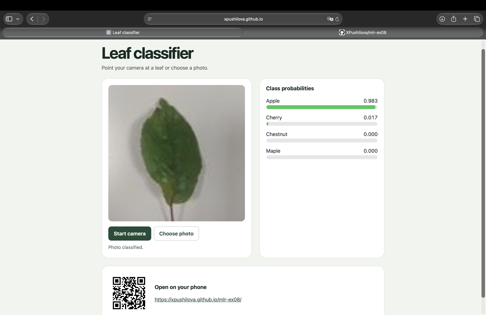

# Review — Task 2

 1. Web page and QR code

Location: index.html, qr.png, README.md, browser_check.png.

Check: I opened the web page in Safari, uploaded a leaf photo and checked the QR code.

Finding: The page shows the leaf and all four class probabilities. The QR code points to https://xpushilova.github.io/mlr-ex08/. I saved a screenshot of the browser test.

Fix: No changes needed for the browser page.

 2. Same probabilities

Location: check_image.jpg, check_expected.json, index.html, browser_check.png.

Check: I compared the numbers on the web page with check_expected.json.

Finding: The page shows apple 0.983, cherry 0.017, chestnut 0.000, and maple 0.000. The expected file has the same numbers to three decimal places. The leaf is predicted as apple.

Fix: No changes needed. The browser result matched the expected values.

 3. Image preprocessing

Location: index.html, model_info.json, ex08_student.ipynb.

Check: I checked the image crop, input size, normalization and tensor shape in the code.

Finding: The page uses a center square crop and resizes the image to 96 x 96. It uses RGB values, the mean and std from model_info.json, and input shape 1 x 3 x 96 x 96. This matches the notebook preprocessing.

Fix: No changes needed.

 4. Privacy and files

Location: index.html.

Check: I checked how the page loads files and uses the camera and photos.

Finding: The code runs the ONNX model in the browser. It does not send the photo to a server. The ONNX Runtime library is loaded from jsDelivr, and the model files are loaded from GitHub Pages. I did not check the network requests in the browser developer tools.

Fix: No changes needed in the code.